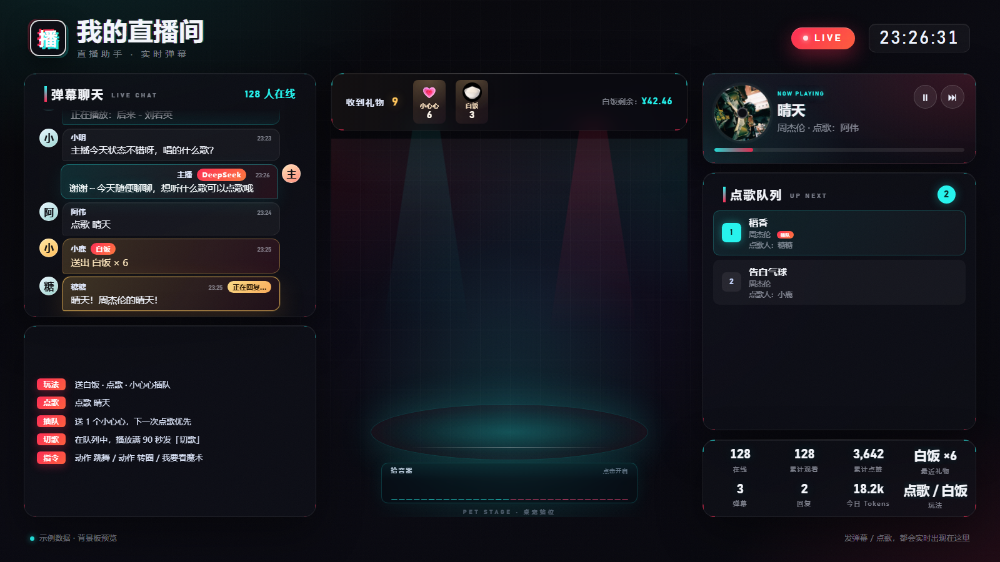
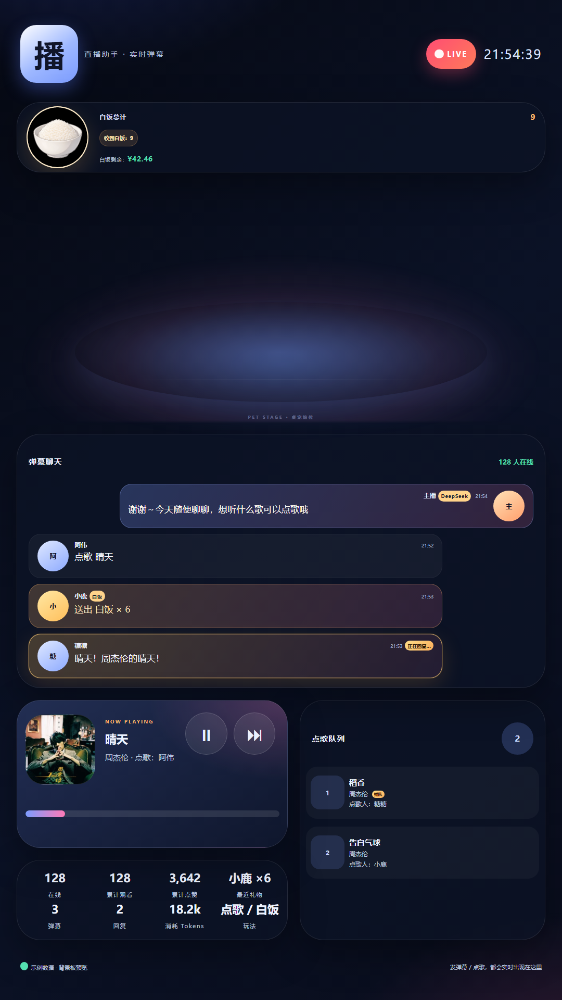
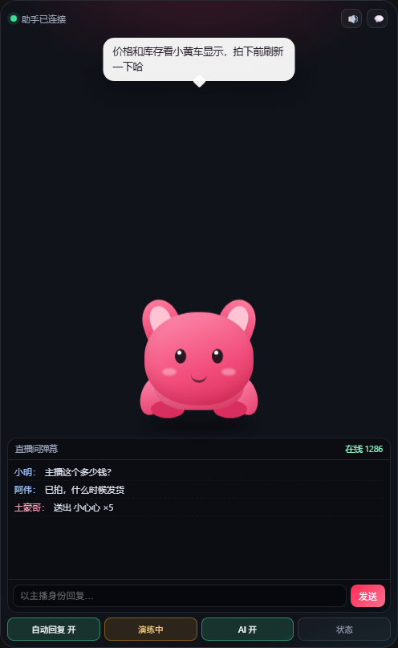

# 抖音直播弹幕助手（主播版）


一个给**正在直播的主播**用的本地浏览器扩展：读取**你自己直播间**的评论 / 弹幕 / 礼物 / 进场 / 关注 / 点赞，按规则自动回复。

- 手机开播、直播伴侣开播都可以用：只要电脑浏览器里打开**自己的直播间**，扩展就能读到弹幕并替你回复
- 纯本地运行，零第三方依赖，不需要 Node 服务端
- 不破解签名、不调用私有接口：直接复用直播间页面自身的 WebSocket 与登录态
- 回复方式为「模拟页面输入 + 点击发送」，会以当前登录账号（也就是你的主播账号）的身份出现在直播间
- 默认**演练模式**，先看匹配结果，确认后再真正发送

> 使用前提：电脑浏览器用**开播的主播账号**登录网页版抖音，打开 **`https://live.douyin.com/你的房间号`** 并保持页面打开。扩展只读取、只回复这个页面所在的直播间。
> 首次使用请先在「设置」里绑定你的直播间，避免误进别人的直播间。

---

## 先确认你的使用方式

| 你的开播方式 | 能否使用 | 怎么用 |
| --- | --- | --- |
| 手机开播 | ✅ | 电脑浏览器登录主播账号，打开自己的直播间页面，扩展挂在这个页面上 |
| 直播伴侣开播 | ✅ | 同上；扩展不读取直播伴侣窗口，但通过网页发出的回复会作为弹幕出现在直播间，直播伴侣里也能看到 |
| 网页开播 | ✅ | 直接用开播的浏览器页面即可 |
| 只有手机、没有电脑 | ❌ | 扩展需要桌面浏览器保持运行 |

如果你在自己的直播间页面里**无法发送评论**（例如平台限制主播在观众端发言），这套「模拟页面输入」的方案就需要换思路，请告诉我，我再调整。

---

## 功能

| 能力 | 说明 |
| --- | --- |
| 主播模式 | 绑定「我的直播间」后只处理这个房间；打开别人的直播间不会触发自动回复 |
| 实时弹幕流 | 评论、礼物、进场、关注、点赞、系统消息分类展示，支持过滤、自动滚动、清空 |
| 数据统计 | 在线观众、累计观看、收到消息数、已回复数 |
| 自动回复 | 只对聊天消息和点歌命令自动回复；礼物 / 进场 / 关注 / 点赞只展示，不自动答谢 |
| 模板变量 | `{nickname}`、`{content}`、`{gift}` 等，支持 `{{A|B}}` 随机文案 |
| 限流保护 | 全局发送间隔、每分钟上限、单用户上限、规则冷却、每人一次、队列上限 |
| 过滤 | 屏蔽关键词、忽略指定用户、忽略主播自己的消息、忽略自己回复的回显 |
| 演练模式 | 完整走规则与队列，但不真正发送；日志中标记 `[演练]` |
| AI 回复 | DeepSeek 主 + MiniMax 备用；默认所有评论走 AI，也可只在规则未命中时兜底 |
| 语音朗读 | MiniMax TTS，默认 `Chinese (Mandarin)_Cute_Spirit` 幼小可爱音色；失败默认静音并记录，不再自动切机械音 |
| 暖场发言 | 人少 / 长时间没人说话时，AI 自动说一句暖场话：发公屏、桌宠气泡、MiniMax 语音 |
| 互动剧场 | 到点自动开演 4～10 幕 AI 短剧，桌宠念旁白，观众用 A/B/C/D 弹幕投票决定剧情走向 |
| 你画我猜 | 桌宠在背景板逐笔作画，观众发弹幕猜词，第一个猜中的拿积分 |
| 观众亲密度 | 按抖音 ID 累计发言 / 礼物 / 点赞 / 到场，分 10 级称号，背景板昵称旁显示等级 |
| 直播背景板 | OBS 浏览器源画面，实时显示弹幕流水席、AI 回复、在线人数和点歌队列；中间舞台可直接播放 DSH 桌宠本体动画并同步语音；底部显示白饭统计和 API 额度 |
| 系统拾音器 | OBS 里用普通浏览器打开 `/pickup` 采集系统音频，背景板 32 段电平实时跳动 |
| OBS 摄像头 | 桥接启动时通过 obs-websocket 检查并自动开启虚拟摄像头，OBS 重启后直播伴侣不再黑屏；`npm run obs:fit` 一键校正横竖屏场景 |
| 弹幕点歌 | 观众发「点歌 歌名」；调用 QQ 音乐客户端播放，网易云 / 酷狗适配；每首至少播 60 秒，小心心可插队 |
| 桌宠联动 | 直接接 DSH 里的 dsh-pet（气泡/动作/右键菜单/TTS）；也支持本地桥接给其他桌宠 |
| 事件转发 | 可选，把弹幕 / 回复以 JSON POST 到 Webhook，便于二次开发 |
| 记录与导出 | 发送成功、队列丢弃与错误记录；弹幕导出 CSV；配置导入导出（不含 API Key） |
| 单实例锁 | 侧边栏和独立标签页同时打开时，只有一个实例会真正发送，避免重复回复 |

---

## 安装

环境：Chrome / Edge **116+**（需要 `sidePanel` 与 `world: "MAIN"` 内容脚本支持）。

1. 下载或克隆本仓库。
2. 打开 `chrome://extensions`（Edge 为 `edge://extensions`），开启右上角「开发者模式」。
3. 点击「加载已解压的扩展程序」，选择本仓库的 **`extension`** 目录。
4. 用**开播的主播账号**登录网页版抖音，打开你自己的直播间，并**刷新页面**（让内容脚本注入）。
5. 点击浏览器工具栏的扩展图标打开侧边栏，在顶部「主播模式」卡片里绑定你的直播间（粘贴链接或点「用当前页」）。

绑定后状态应变为绿色「已连接 · 我的直播间」，弹幕开始滚动即表示链路正常。

> 安装或更新扩展后，已经打开的直播间需要刷新一次；侧边栏也需要关闭重开。
> 想长时间挂机时可以点右上角 `⤢` 在独立标签页打开本页面，但请只保留一个助手页面处理自动回复。

### 用 DeepSeek Harness 一键准备

把仓库链接丢给 DSH，让它读 [`AGENTS.md`](AGENTS.md)，它会检查 Node、后台启动桥接、打开扩展管理页 / 背景板 / 直播间：

```powershell
powershell -ExecutionPolicy Bypass -File tools/quick-start.ps1 -Room "https://live.douyin.com/你的房间号"
```

加 `-CheckOnly` 只做环境体检、不启动任何服务。脚本无法替你点「加载已解压的扩展程序」——这一步浏览器不允许自动化，手动选一次 `extension` 目录即可；之后每场开播只要重跑上面的命令。

---

## 快速上手

1. **绑定直播间**：首次打开侧边栏，看到「先绑定你的直播间」，粘贴 `https://live.douyin.com/你的房间号` 或点「用当前页」。
2. **看数据**：确认在线人数、弹幕在实时更新。
3. **配规则**：进入「规则」，内置了聊天类模板（新人欢迎、关键词回复），默认关闭。当前版本只对聊天执行规则；礼物 / 关注 / 进场 / 点赞模板保留但不会触发。
4. **先演练**：「设置」里保持「演练模式」开启，回到「直播」页打开顶部「自动回复」。
5. **看记录**：在「记录」里确认命中的规则和生成文案。
6. **正式发送**：关闭演练模式，回复会真实发送到你的直播间。建议把「全局发送间隔」保持在 3 秒以上。
7. **接桌宠**：设置 → DSH 桌宠联动 → 启用 → 测试气泡。DSH 里已安装的 dsh-pet 会直接显示 AI 回复和礼物反馈；语音默认用 MiniMax「幼小可爱 Cute Spirit」。其他桌宠可用 `node bridge/server.mjs`。
8. **暖场**：设置 → 暖场发言 → 启用；可以先点「立即暖场一次」试听效果。
9. **背景板**：先 `npm run bridge`，设置 → 直播背景板 → 启用 → 选桌宠站位 → 复制 OBS 地址，在 OBS 里添加「浏览器源」（1920×1080）。桌宠动画会直接在网页里播放，不再需要窗口捕获。
10. **点歌**：设置 → 点歌 → 启用；观众发「点歌 晴天」，会自动加入点歌队列。

### 主播场景建议

- 先用**关键词回复**接住「价格 / 怎么买 / 链接 / 教程」这类高频问题，不要一上来对所有弹幕自动回复。
- **进场欢迎 / 关注答谢 / 礼物答谢**当前不会自动触发，这些事件只在列表和背景板展示；如果以后想恢复，再单独打开。
- **点歌**：同一用户再次点歌时，回复会提示「送小心心可插队」；队列每条都显示点歌人，按用户 ID 区分。
- 大促或高流量场次，把「每分钟最多回复」调到 10～20，宁可少回，不要触发风控。
- 想用 AI 兜底时，把 AI 当成「没有规则命中时的补充」，不要让它对所有弹幕发言。

---

## 规则说明

### 触发场景

| 场景 | 触发条件 | 可配置项 |
| --- | --- | --- |
| 评论 / 弹幕 | 观众发言命中关键词 | 关键词、匹配方式（包含 / 完全等于 / 前缀 / 正则 / 不限制） |
| 点歌 | 观众发「点歌 歌名」 | 独立走点歌队列，不参与自动回复规则 |

当前版本**只执行聊天类规则**；礼物 / 进场 / 关注 / 点赞只显示，不会触发自动回复，也不会自动答谢。点歌命令由独立流程处理。

**主播自己**的评论、进场、礼物、关注、点歌和动作指令都会被忽略，不触发回复、插队资格或桌宠动作；仍然会显示在记录/背景板里。识别优先用「我的昵称 / 我的用户 ID」，没填时从直播间标题「XXX的抖音直播间」兜底。

点歌**成功和失败都会通过桌宠语音播报**；失败不会发到公屏，成功是否发公屏仍由「在直播间回复点歌结果」控制。

匹配按规则列表顺序进行，默认一条消息只回复一条（可在设置里改）。列表里用 `↑` `↓` 调整顺序。

### 文案模板

- `{nickname}` 观众昵称
- `{content}` 观众原话
- `{gift}` 礼物名称
- `{count}` 礼物 / 点赞数量
- `{level}` 用户等级
- `{fansClub}` 粉丝团名称
- `{online}` 在线人数（形如 `1.2万`）
- `{cumulative}` 累计观看
- `{time}` 当前时间
- `{{老板大气|感谢支持}}` 随机选一个

每行一条回复，「随机选一条」或「按顺序轮换」发送。单条会被截断到设置的「单条回复字数上限」。

### 限流优先级

一条回复需要同时通过以下检查：

1. 全局发送间隔（距上次发送的毫秒数）
2. 全局每分钟上限
3. 同一用户每分钟上限
4. 规则自身的「同一用户冷却」
5. 规则自身的「每分钟上限」
6. 规则「每人只回复一次」（如启用）

未通过时不会发送，也不会进入队列；「记录」里只记录已进入发送流程的结果。回复队列另有长度上限，超出会丢弃并写入提醒日志。

---

## 设置

| 设置 | 默认 | 说明 |
| --- | --- | --- |
| 我的直播间链接 | 空 | 主播模式绑定的房间；未绑定不会自动回复 |
| 我的昵称 | 空 | 用于忽略主播自己发出的弹幕，避免自问自答 |
| 我的用户 ID | 空 | 可选，比昵称更精确 |
| AI 回复 | 开 / 关 | 开启后按「回复模式」决定是否由 AI 接管评论 |
| 回复模式 | 所有评论走 AI | 「所有评论走 AI」或「仅无规则命中时走 AI」 |
| AI 回复冷却 | 5 秒 | 同一用户两次 AI 回复的最小间隔 |
| 演练模式 | 开 | 只匹配不发送，强烈建议先用它验证规则 |
| 全局发送间隔 | 3 秒 | 两条回复之间的最小间隔 |
| 每分钟最多回复 | 12 | 防止刷屏与风控 |
| 同一用户每分钟 | 3 | 避免对同一个人连续回复 |
| 单条回复字数上限 | 60 | 抖音评论有长度限制，上限 100 |
| 单条消息最多回复条数 | 1 | 多条规则同时命中时的上限，最大 3 |
| 待发送队列上限 | 20 | 高频直播间防止堆积 |
| 忽略自己回复的回显 | 开 | 自己发出的回复也会作为弹幕回流，必须避免自触发 |
| 屏蔽关键词 | 空 | 每行一个，命中后不自动回复 |
| 忽略用户 | 空 | 每行一个昵称或用户 ID |
| 桌宠联动 | 关 | 启用后通过本地桥接推送事件、接收桌宠指令 |
| 桥接地址 | `http://127.0.0.1:8787` | `node bridge/server.mjs` 的监听地址 |
| DSH 桌宠联动 | 关 | 直接连接 DSH 里的 dsh-pet |
| DSH 地址 / 桌宠 ID | `http://127.0.0.1:64864` / `main` | 当前 DSH 端口与宠物 ID |
| 语音朗读 AI 回复 | 关 | 用 MiniMax TTS 念出 AI 回复；失败默认静音，不自动切机械音 |
| TTS 音色 | Cute Spirit | 默认 `Chinese (Mandarin)_Cute_Spirit`，音调 +2、emotion happy |
| 弹幕气泡播报 | 开 | 每 N 秒在桌宠气泡显示一条评论 |
| 直播背景板 | 关 | 通过 `bridge/server.mjs` 给 OBS 提供弹幕/点歌画面，舞台自动播放 DSH 桌宠 |
| 桌宠站位 | 中间 | 背景板预留中间 / 左 / 右空位，同时决定桌宠舞台位置 |
| 互动剧场 | 开 | 到点自动开演 AI 短剧，观众弹幕投票决定走向 |
| 剧场间隔 | 90 分钟 | 两场之间的最短间隔，可调 20～240 分钟 |
| 剧场主题 | 空 | 留空从题材池随机；也可以随时发「剧场 主题」点播 |
| 你画我猜 | 开 | 允许观众发「你画我猜」开局，也可在设置里手动开一局 |
| 每场题数 | 5 | 3～10 题，题数用完自动收场 |
| 每题秒数 | 60 | 30～120 秒，画完最后一笔后开始计时 |
| 弹幕点歌 | 关 | 观众发「点歌 歌名」，调用本机音乐客户端 |
| 点歌播放器 | 自动 | 自动优先 QQ 音乐，其次网易云 / 酷狗 |
| 每人点歌冷却 | 60 秒 | 同一观众两次点歌的最小间隔 |
| 每首歌最少播放 | 60 秒 | 没满这个时间不切歌；插队也要等 |
| 插队礼物 | 小心心 | 送礼获得一次插队资格，下一次点歌生效 |

### AI 智能回复（推荐）

开启后默认采用「AI 优先」：**每一条通过过滤的评论都交给 AI 生成回复**；礼物 / 进场 / 关注 / 点赞仍然按规则处理。
如果希望规则优先、只有没命中时才 AI 兜底，把「回复模式」改成「仅无规则命中时」。

| 服务 | Base URL | 默认模型 |
| --- | --- | --- |
| DeepSeek | `https://api.deepseek.com/v1` | `deepseek-chat` |
| MiniMax（国内） | `https://api.minimax.cn/v1` | `MiniMax-M3` |
| MiniMax（国际） | `https://api.minimax.io/v1` | `MiniMax-M3` |

- **主服务**：默认 DeepSeek。
- **备用服务**：主服务请求失败（超时 / 限流 / 额度 / 网络）时自动切换 MiniMax，需要单独填备用 Key。
- MiniMax M3 是思考模型，扩展会自动加 `thinking: {"type": "disabled"}`，避免思考过程吃光 token 导致空回复；M3.1 则使用低思考档位。
- `AI 回复冷却` 默认 5 秒，和全局发送间隔、每分钟上限共同限流。
- 系统提示词默认要求 30 字以内、不承诺价格、不引导私下交易。
- Key 只保存在本机 `chrome.storage.local`，不会写进扩展源码；「导出配置」也不会包含 Key。

首次启用或点「测试 AI」时，浏览器可能会请求访问接口域名，请点允许。DeepSeek / MiniMax 的官方域名已包含在扩展权限中，通常不会弹窗；自定义接口（如本地 Ollama）首次会请求授权。若 MiniMax 国内 Key 返回 401 / 1004，把主服务切换成「MiniMax（国际）」再试。

> AI 优先模式下，**评论规则不会触发**（避免规则和 AI 同时回复）；礼物 / 进场 / 关注 / 点赞规则不受影响。
> 高频直播建议先小流量观察「记录」里的延迟、余额和错误，再逐步放开频率。

### 事件转发（可选）

开启后，每个事件会以 `POST` JSON 发送到 Webhook 地址：

```json
{
  "source": "dy-live-companion",
  "kind": "event",
  "at": 1730000000000,
  "room": { "roomId": "7123456789", "title": "直播间标题", "url": "https://live.douyin.com/..." },
  "event": {
    "id": "WebcastChatMessage:123",
    "type": "chat",
    "ts": 1730000000000,
    "content": "这个多少钱",
    "user": { "id": "42", "nickname": "小明", "avatar": "https://...", "level": 12 }
  }
}
```

发送成功时还会额外推送一条 `kind: "reply"`：

```json
{
  "kind": "reply",
  "reply": { "text": "小明 点击小黄车~", "ruleId": "r1", "ruleName": "关键词回复", "dryRun": false, "method": "click" }
}
```

仓库自带一个零依赖接收器：

```bash
node examples/webhook-receiver.mjs
# Webhook 接收器已启动：http://127.0.0.1:8788/events
```

然后在设置里填写 `http://127.0.0.1:8788/events` 并开启转发。事件会追加写入 `examples/events.jsonl`。首次开启时同样需要在浏览器弹窗中允许访问该地址。

---

## 暖场发言

直播间没人说话、或者在线人数很少时，自动让 AI 说一句自然的暖场话，避免冷场。

- **无人说话**：默认 90 秒没有新评论就触发。
- **人少**：在线人数 ≤ 10（可改）时，只需要安静 45 秒就触发。
- **防刷屏**：最短间隔 150 秒，每小时最多 12 条（都可改）。
- **三种出口**：发到直播间公屏、显示在 DSH 桌宠气泡、用 MiniMax TTS 念出来；可分别开关。
- **随机观众**：从最近 10 分钟发过言 / 进场 / 送礼 / 关注的观众里随机挑一个，自然叫出昵称打招呼；不会选主播自己，也不会连续选同一个人。
- **预设暖场语**：可以自己写多条（每行一条），按「预设出现概率」随机使用；一条预设不会包揽所有暖场，其余仍由 AI / 内置文案补上，刚用过的预设会避开。
- **不重复**：会把最近暖场文案传给 AI，并在本地兜底文案里避开刚说过的。
- **兜底**：AI 失败 / 未配置时，使用内置的 6 条暖场话。
- **不会抢话**：正在生成 AI 回复、发送队列非空、或直播已断流时不会触发；顶部「自动回复」总开关关闭时，自动暖场也会暂停。

设置项在「设置 → 暖场发言」：

| 设置 | 默认 | 说明 |
| --- | --- | --- |
| 启用自动暖场 | 开（配置文件） | |
| 无人说话 | 90 秒 | 安静多久触发 |
| 人少阈值 | 10 人 | 在线 ≤ 该值按「人少」处理；0 = 关闭人少判断 |
| 人少时等待 | 45 秒 | 人少时只需安静这么久 |
| 最短间隔 | 150 秒 | 两次暖场的最小间隔 |
| 每小时最多 | 12 条 | 防止整点刷屏 |
| 随机挑观众打招呼 | 开 | 从最近观众里随机选一个，把昵称带进暖场话 |
| 预设暖场语 | 空 | 每行一条，支持 `{name}` 占位；不会每次都只用预设 |
| 预设出现概率 | 30% | 其余交给 AI / 内置文案；设为 100% 也不会连续重复同一条 |
| 发到直播间公屏 | 开 | 以主播账号发一条评论；演练模式下只模拟不发送 |
| 桌宠气泡 | 开 | 需要 DSH 桌宠联动已启用 |
| 语音朗读 | 开 | MiniMax TTS，使用「语音朗读」里配置的音色 |
| 立即暖场一次 | — | 手动测试，不受间隔限制 |

右键桌宠菜单里也有 `暖场：开/关`。

> 如果直播间正在快速刷评论，暖场不会触发；它只在真的安静或人少时工作。

---

## 直播背景板



给 OBS 用的背景画面：左边是弹幕流水席（评论、礼物、进场、关注），AI 回复会突出成「主播」气泡；右边是在线人数和点歌队列；**中间预留了桌宠站位**（聚光灯 + 地面光圈）。
桌宠站位现在会**直接播放 DSH 里那只桌宠的动画素材**：桥接自动发现 DSH 端口，从 dsh-pet 取回待机 / 点击回应 / 分类动作的 webm，在网页里循环播放，并跟着礼物、关注随机插动作；扩展推给 DSH 的气泡和 MiniMax 语音也会同步到舞台，`?petVoice=0` 可关掉声音。这样 OBS 里**不需要再窗口捕获桌宠**，Windows 之外的系统也能直接用。
如果没装 DSH 或没开桌宠，舞台会显示一行提示，不影响弹幕和点歌。
正在被回复的那条弹幕 / 礼物会高亮，显示「正在回复…」，发送完成后变成「已回复」；回复失败会标红。
白饭面板现在位于**桌宠舞台正上方**，约占中间列 20% 高度，带白饭图标、`收到白饭：9` 总计和 `白饭剩余：¥42.46`。
评论区改成**微信式左右气泡**：观众弹幕在左，桌宠 / AI 回复在右；评论 item 已缩小，显示更多条数。
横屏底部统计新增：**在线、累计观看、累计点赞、最近礼物、弹幕、回复、今日 Tokens、玩法**；Tokens 按上海日期统计，跨日自动归零，历史总量仍保留。
横屏左侧聊天框已压缩到约 55%，下方固定「玩法 / 点歌 / 插队 / 指令」提示。
背景板同时用 SSE 和每 2 秒的 `/api/board/state` 兜底，并按键 id 去重；在单独浏览器或 OBS 里即使 SSE 被缓冲/断开，也会在 2 秒内补上。
如果放入后台标签后仍不刷新，是 Chromium 的后台节流：切回页面会立即补一次；启动器 `tools\open-board.ps1` 会用独立窗口并关闭后台节流，也可以点一下背景板页面启用静音保活。

### 竖版 9:16

OBS 里新建「浏览器源」，分辨率设为 **1080 × 1920**，地址用：

```text
http://127.0.0.1:8787/board/vertical
```

竖版会按「白饭 → 桌宠舞台 → 弹幕聊天 → 当前播放 / 点歌队列 / 统计」纵向排列，桌宠舞台同样直接播放 DSH 动画。也可以用 `?layout=vertical` 手动切换。

> OBS 清晰度：浏览器源宽高必须和画布一致（例如画布 1080×1920 就用 1080×1920），不要先用小尺寸再放大；场景属性里关闭「不可见时关闭源」，切场景后右键「刷新页面」。竖版已关闭面板模糊、提高字号和对比度。



### 启动

```bash
npm run bridge
# 桌宠桥接已启动：http://127.0.0.1:8787
# 直播背景板：http://127.0.0.1:8787/board
```

1. 扩展「设置 → 直播背景板」勾选启用，点「测试连接」。
2. 选「桌宠站位」（中间 / 左侧 / 右侧 / 不预留），点「复制 OBS 地址」。
3. 在 OBS 添加 **浏览器源**，宽高 1920×1080，粘贴地址。
4. 桌宠舞台会用网页里的 webm 自己播，**不需要**再添加窗口捕获；如果你想用桌宠的真实透明窗口，也可以额外加一个窗口捕获叠上去。
5. 建议勾选「关闭源时关闭页面」；背景板会自己重连，不需要刷新。

可选 URL 参数：

| 参数 | 作用 |
| --- | --- |
| `?pet=center` | 桌宠站位在中间（默认） |
| `?pet=left` / `?pet=right` | 站位在左 / 右 |
| `?pet=none` | 不预留站位，弹幕区变宽 |
| `?petDebug=1` | 显示站位虚线框，方便和桌宠窗口对齐 |
| `?transparent=1` | 透明背景，只保留半透明面板，方便叠加 |
| `?petVoice=0` | 关掉桌宠舞台的语音，只保留动画和气泡 |
| `?title=我的直播间` | 覆盖左上角标题 |
| `?demo=1` | 填入示例弹幕和点歌，用来调 OBS 排版 |

> 背景板依赖 `bridge/server.mjs` 常驻。扩展里的「本地桥接」如果也启用了，事件会走同一个桥接；没有启用也没关系，勾选「直播背景板」后扩展会自己 POST 事件。

### 拾音器在 OBS 里的用法

OBS 浏览器源没有授权弹窗，直接点背景板上的「拾音器」不会弹出共享窗口（会提示 `OBS 无法授权`）。做法是：

1. 用普通 Chrome / Edge 打开 `http://127.0.0.1:8787/pickup`。
2. 点「开始拾音」，在弹窗里选**整个屏幕**并勾选**「分享系统音频」**。
3. 保持该页面开着（可以最小化），背景板上的 32 段柱状条会实时跟着音乐跳动，状态显示「系统音频 LIVE（外部拾音）」。
4. 拾音停止或页面关闭后约 1.5 秒，背景板自动退回待机光条。

电平走桥接中转：页面每 66ms `POST /api/pickup/levels`，桥接通过 `/events` 的 `pickup` 事件推给背景板，并提供 `/api/pickup/state` 给断线重连兜底。

### OBS 虚拟摄像头自愈

OBS 一重启，虚拟摄像头默认是关的，直播伴侣里「摄像头 → OBS Virtual Camera」就会黑屏。桥接启动时会连一次 obs-websocket，没开就自动帮你开：

1. OBS →「工具 → WebSocket 服务器设置」勾选「启用 WebSocket 服务器」，端口默认 `4455`。
2. 需要鉴权时，把这串密码填到 `bridge/obs.json`（或环境变量 `OBS_WS_PASSWORD`）；没开鉴权就留空：

```json
{ "enabled": true, "port": 4455, "password": "", "attempts": 3, "retryDelayMs": 5000 }
```

3. 之后每次 `npm run bridge`，控制台会打印 `[OBS] 已自动开启 OBS 虚拟摄像头` 或 `已在运行`；OBS 没开就只打印一行提示，不影响桥接其他功能。

> 这个自愈只做「开摄像头」，不改 OBS 场景和推流设置。Node 20 没有内置 WebSocket，需要 Node 22 以上才会生效。

### 横竖屏场景一键校正

OBS 的画布只有一个方向，但背景板有 16:9 和 9:16 两个场景。手动点过「适配屏幕」或拖动源之后，很容易出现黑边或裁切，可以用脚本按画布方向重算一遍：

```bash
npm run obs:fit                          # 按当前画布方向校正场景里的浏览器源
npm run obs:fit -- --canvas 1080x1920    # 先切画布再校正（竖屏直播）
npm run obs:fit -- --canvas 1920x1080    # 横屏
```

- 方向匹配的场景铺满画布（位置 0,0）；方向不匹配的场景等比缩到画布内并居中，留黑边属正常。
- 连接参数读 `bridge/obs.json` 或环境变量 `OBS_WS_PORT` / `OBS_WS_PASSWORD`，默认 `127.0.0.1:4455`、密码留空。
- 切画布时如果虚拟摄像头开着，脚本会先停掉、切完再开（OBS 不允许运行中改输出分辨率）。
- 只改浏览器源的缩放和位置，不动其他源、滤镜和推流设置。

---

## 互动剧场

到点自动开演一场 4～10 幕的 AI 互动短剧（每场幕数随机）：桌宠念旁白，观众在弹幕里投票决定剧情走向，演到最后一幕自动收尾。

- **自动开演**：默认每 90 分钟一场，可调 20～240 分钟；「设置 → 互动剧场」可以指定主题，留空就从题材池随机。
- **弹幕投票**：每幕 30 秒，观众发 `A` / `B` / `C` / `D` 或 `1`～`4`，也认 `选A`、`A选项`；平票时背景板转 4 秒轮盘决定。
- **观众点播**：发 `剧场 大肥鱼失去尾巴`（`剧场` 后可带空格、冒号、顿号），主题 1～20 字，随时开一场。
- **展示**：剧情面板在背景板左侧，显示当前幕、票数和倒计时；桌宠会配合动作和语音，没连桌宠也能只靠背景板演。
- **需要 AI 接口**：复用「设置 → AI 智能回复」里配好的服务和 Key；AI 失败或返回格式不对时这一场直接结束，不会把半截剧情留在画面上。
- **内容安全**：政治、宗教、暴力、色情等题材和敏感措辞在提示词与解析层都会被拦掉，命中就换安全剧情。
- 设置页可以「现在开演一场 / 结束当前剧情」，也可以只关掉自动开演、保留手动点播。

---

## 观众亲密度

按抖音 ID 分人累计，跨场次保留，背景板会在昵称旁显示等级和称号。

- 发言、点赞、送白饭、点歌、关注都会加分；每天第一次到场额外 +3 分。
- 连续到场两天起，当天积分 ×1.2。
- 等级从「路人」到「命定饭票」共 10 级，积分门槛 0 / 10 / 25 / 50 / 90 / 150 / 240 / 380 / 600 / 1000。
- 等级只用于称呼、感谢口吻和背景板标识，不影响限流和回复权限。
- 数据只存在本机浏览器里，不会上传。

---

## 观众记忆

- 单场直播内记住观众的发言（最多 20 条）、点歌、送礼、关注和点赞，用来回答「还记得我吗」。
- 每场结束会把重要观众存档到本机；下次进场时，桌宠可以说出「上次点了什么歌、送过什么礼物、点过多少赞」的老朋友重逢彩蛋。
- 存档只保留最近几条具体行为，控制在 72 字以内，避免念得太长；数据同样只存在本机。

---

## 你画我猜

观众发「你画我猜」就能开一场：桌宠在背景板上一笔一笔画出内置简笔画，弹幕猜答案。

- 默认 3～10 题（默认 5 题），每题最多 60 秒（可调 30～120 秒），全部画完后自动收场。
- 画完最后一笔会公布类别和字数，剩 25 秒时自动给一句提示。
- 第一个猜中的观众拿积分，积分按上海日期保存在本机，跨日重置。
- 观众可以发「提示」「下一题」「结束画画」；主播也可以在「设置 → 你画我猜」点「开始一局 / 结束当前局」。
- 设置里可以关闭观众弹幕开局、修改每场题数（3～10）和每题秒数（30～120）。
- 对局进行中弹幕只当猜词处理，不会触发 AI 回复或规则回复；开画前发出、收场后才返回的 AI 回复也会直接作废，不会补发到直播间。
- 展示需要背景板或 DSH 桌宠；和互动剧场共用主舞台，同一时间只会开一个。

---

## 点歌

观众在弹幕里发：

```text
点歌 晴天
点歌 周杰伦 晴天
```

扩展会识别命令（默认前缀 `点歌`，可改），调用本地桥接搜索歌曲、加入队列，并在直播间回复：

```text
已为 小明 点歌：晴天 - 周杰伦（队列第 1 位）
```

### 播放器支持

| 播放器 | 搜索 | 播放方式 | 当前状态 |
| --- | --- | --- | --- |
| QQ 音乐 | QQ 搜索接口（20 条结果 + 版本匹配） | `QQMusic.exe /playbysongid <songid>` 直接调客户端 | ✅ 本机已安装并实测 |
| 网易云音乐 | 网易云搜索接口 | 已安装：`orpheus://song/<id>`；未安装：网页播放页 | 本机未安装，适配已写好 |
| 酷狗音乐 | 酷狗 `song_search_v2` | 已安装：`kugou://` 协议；未安装：网页播放页 | 本机未安装，适配已写好 |

- 「设置 → 点歌 → 播放器」可以选 `自动 / QQ / 网易云 / 酷狗`；自动会优先用检测到的客户端。
- 点「测试点歌」会直接搜索并播放一首，用来确认客户端能被调用。
- 英文歌名会原样搜索，不翻译成中文；混合查询（如「i love you 邓紫棋版」）会额外按歌名再搜一次，优先标题匹配，指定歌手/版本不存在时会注明「没找到…，已选…」。
- QQ 搜索一次取 20 条，并优先匹配点歌里的版本词：例如「雨爱 司凤版」会选《雨爱 (司凤版)》，「司风版」也支持同音匹配；没有对应版本才回退到原版。
- VIP、地区限制、登录状态都由音乐客户端自己处理；扩展不下载音频、不绕过版权限制。
- 未安装对应客户端时会回退到网页播放页，仍然能完成搜索和播放，但音质/登录取决于网页。

### 播放规则

> 更新扩展后**必须重启桥接**：旧的 `node bridge/server.mjs` 会继续用旧逻辑，表现为「显示在播但没有声音」或队列不对。`npm run bridge` 如果提示 8787 被占用，先结束旧的 Node 进程。

- **每首歌最少播放 60 秒**（可改）：当前歌曲没满 1 分钟时，任何点歌都只排队，不切歌。
- **普通点歌**进入队列；队列有人时，当前歌曲最多再占 90 秒（可调 60～180），到点自动切队列第一首。
- **队列空**：当前点歌播完自动接「每日推荐」歌曲（QQ 推荐新歌，按上海日期缓存），推荐曲不占点歌队列。
- 每日推荐曲正在播放时有人点歌，新歌**先排队**，不会把推荐曲切走；推荐曲播完或满 90 秒后按正常规则切到点歌队列。
- QQ 实际播放和队列记录连续两轮对不上（手动切歌、播完停在别的歌），会自动清掉当前记录，背景板直接跟随 QQ 的真实播放状态。
- **无人点歌**：背景板同步系统当前播放歌曲，并提示「可点歌」。
- **小心心插队**：观众送一个「小心心」会获得一次插队资格（默认 10 分钟内有效），下一次点歌会排到普通队列前面。
- 插队也**不会立刻切歌**：当前歌曲必须已经播放满 60 秒才会切；如果只播了 10 秒，会等到第 60 秒再切。
- 多首插队按到达顺序排；手动点背景板 `⏭` 仍然立即切。
- 连击礼物只给一次插队资格，第一击就生效；已有未使用资格时不叠加。暂停期间插队不会切歌，恢复后满最少播放时间才切。
- 队列最多 30 首，同一用户默认 60 秒冷却，重复歌曲不会重复加。
- 每条队列显示点歌人；点歌人按用户 ID 区分，同名观众不会混在一起。
- 同一用户再次点歌时，回复会自动提示「送小心心可插队」。
- 「测试点歌」会**立即切歌**（原歌曲放回队列），不受当前歌曲最少播放时间限制，专门用来验证客户端是否真的出声。
- 队列空时按歌曲时长播完自动接每日推荐；队列有人时最多 90 秒就切；也可以点背景板上的 `⏸` / `⏭`，或调用桥接的 `/api/song/pause`、`/api/song/skip`。
- 点歌不受「演练模式」影响：即使演练模式开着，点歌也会真的播放音乐；如果只想测试队列，先把系统音量调低。

### 弹幕调音量

观众发「音量调到40」「声音30%」「音量调到五十」「声音大点」「小点声」「音量最大 / 最小」「音量加10」都会调节本机 QQ 音乐的音量：

- 中文数字也认：`音量调到五十` = 50，`音量调到百分之五十` = 50，`声音调到十五` = 15；「音量调到一半」「十点五」这类不算明确数值，会被忽略。
- 允许范围固定 20%~70%：超出范围按边界生效，并回复「音量限 20%~70%，已调到 70%」。
- 需要本地桥接常驻；桥接没启动时回复「音量服务未连接，请稍后再试」。

设置项：

| 设置 | 默认 | 说明 |
| --- | --- | --- |
| 每首歌最少播放 | 60 秒 | 低于这个时间不切歌 |
| 队列有人时最多播放 | 90 秒 | 到点自动切队列第一首，可调 60～180 |
| 队列空自动每日推荐 | 开 | QQ 推荐新歌，按上海日期缓存 |
| 插队礼物 | 小心心 | 逗号分隔，可加多个礼物名 |
| 插队资格有效 | 600 秒 | 送礼物后多久内点歌有效 |

> 非官方接口可能会随平台改版失效；建议只在自己直播、个人试听场景使用。

---

## 桌宠联动

### 方式一：直接接 DSH 里的 dsh-pet（当前已安装，推荐）

你现在这套 DSH 装的是 **dsh-pet**。它自带一组本机 HTTP 路由，扩展可以直接把弹幕、礼物、AI 回复投喂到桌宠气泡和动作里，**不需要额外开桥接进程**。

打开扩展「设置 → DSH 桌宠联动」：

| 配置 | 建议值 | 说明 |
| --- | --- | --- |
| 启用 DSH 桌宠联动 | 开 | |
| DSH 地址 | `http://127.0.0.1:64864` | 当前 DSH Web 端口；重启后端口变了要改 |
| 桌宠 ID | `main` | 点「读取宠物列表」可看到实际 ID |
| 显示端 | 桌面窗 | 你的配置是 `display: desktop` |
| 语音朗读 AI 回复 | 开 | 使用 MiniMax TTS（Cute Spirit）；失败默认静音，不自动切机械音 |
| 弹幕气泡播报 | 开 | 每 N 秒挑一条评论显示，AI 回复时不抢 |
| 注册右键菜单 | 开 | 右键桌宠可控制直播助手 |

点「测试气泡」，桌宠头顶会出现测试文字；点「读取宠物列表」会列出当前所有宠物 ID。

互动行为：

| 直播事件 | 桌宠反应 |
| --- | --- |
| AI 回复 | 头顶气泡 + 说话动画 + 语音朗读（可关） |
| 礼物 | 所有礼物统一显示为「白饭」；感谢气泡 + 开心跃动动画 + 语音（连击结束才播） |
| 关注 | 感谢气泡 + 元气挥手动画 + 语音 |
| 进场 | 欢迎气泡 + 元气挥手动画 + 语音（8 秒内合并） |
| 点赞 | 聚合点赞后感谢气泡 + 开心跃动 + 语音，10 秒内最多一次 |
| 评论 | 每 N 秒（默认 20 秒）挑一条显示；AI 正在回复时不抢 |
| 右键菜单 | `自动回复：开/关`、`演练模式：开/关`、`AI 回复：开/关`、`弹幕播报：开/关`、`暖场：开/关`、`语音：开/关`、`测试气泡` |

弹幕动作指令默认开启：`动作 跳舞`、`/动作 转圈`、`跳个舞`、`挥挥手`、`比个心`、`睡觉`、`伸懒腰`、`吃白饭`、`吃西瓜`、`火锅`、`放烟花`、`魔术`、`撸猫`、`下棋`、`小提琴`、`中秋`、`春节`、`生日` 等。桥接会优先用 dsh-pet 配置里的动画名做包含/同义词匹配，匹配不到时随机播一个自带动作；动作会同时用桌宠语音回应用户，不会发公屏。可在设置里关闭「弹幕动作指令」。

实现走 dsh-pet 自带的这些接口（只访问本机）：

- `GET /dsh-pet-7340/config` 读取宠物列表
- `POST /dsh-pet-7340/broadcast?pet=main&surface=desktop` 写气泡
- `POST /dsh-pet-7340/anim?pet=main&surface=desktop` 点播动画
- `POST /dsh-pet-7340/menu/item` 注册右键菜单
- `GET /dsh-pet-7340/menu/events?owner=dy-live-companion&wait=...` 长轮询菜单点击

DSH 重启后菜单会被清空，扩展会自动重新注册；侧边栏关闭期间点右键菜单，点击会暂存，重新打开侧边栏后再处理。

> **端口**：当前 DSH 是 `64864`。如果 DSH 重启后端口变化，把扩展里的「DSH 地址」改成新端口即可。
> **语音**：由扩展调用 MiniMax TTS 合成并播放，不是 dsh-pet 的功能。默认不会自动回退浏览器机械音；如果没声音，点「测试语音」看错误原因。

#### 音色：幼小可爱（MiniMax TTS）

默认音色是 **`Chinese (Mandarin)_Cute_Spirit`**，配合 `pitch = 2`、`emotion = happy`，就是偏幼小、软萌的少女音。可以在「设置 → 语音朗读」里换：

| 音色 | voice_id | 感觉 |
| --- | --- | --- |
| 幼小可爱（默认） | `Chinese (Mandarin)_Cute_Spirit` | 最幼、最软萌，适合小女仆桌宠 |
| 甜美少女 | `Chinese (Mandarin)_Sweet_Lady` | 更甜、稍成熟一点 |
| 温柔女孩 | `Chinese (Mandarin)_Warm_Girl` | 温柔自然，适合长时间说话 |
| 软萌女孩 | `Chinese (Mandarin)_Soft_Girl` | 轻声软糯 |
| 害羞少女 | `Chinese (Mandarin)_BashfulGirl` | 有点害羞的语气 |
| 清脆少女 | `Chinese (Mandarin)_Crisp_Girl` | 清脆活泼 |

- 想更幼：把「音调」从 2 调到 3～5；再高可能会失真。
- 语速默认 1.0；桌宠卖萌可以略慢到 0.95。
- 模型默认 `speech-2.8-hd`，音质最好；想省钱可在高级里改 `speech-2.6-hd`。
- 也可以切到 **MiMo TTS**（`https://api.xiaomimimo.com/v1`，模型 `mimo-v2.5-tts`，音色「冰糖」，或 `mimo-v2.5-tts-voicedesign` 走文字描述音色）；MiMo 的 Key 不会误用 MiniMax 的备用 Key。
- API Key 留空时自动复用「AI 备用服务」里的 MiniMax Key；也可以单独填。
- 点「测试语音」会播放一句示例。第一次可能被浏览器自动播放策略拦截，点一下页面再试。
- **机械音的原因**：以前 MiniMax 失败会自动回退浏览器 `speechSynthesis`，听起来就是机械音。现在默认关闭这个回退：MiniMax 成功就播 Cute Spirit，失败就静音并在「记录」里写原因，不会再偷偷换成机械音。
- 如果确实想要失败兜底，可在「语音朗读」里勾选「MiniMax 失败时用浏览器机械音兜底」。
- **暖场提示词**现在会同时写进 system prompt 和 user prompt，并标注「优先级最高，必须遵守」，不再只是附加一句风格建议。
- MiniMax TTS 请求约 1 秒，AI 生成 + 合成后通常 2～4 秒出声；文字气泡会先出现。
- 播放优先用 Web Audio（更稳），被自动播放策略拦截时再尝试 `<audio>`；两者都失败才报错。

### 方式二：本地桥接 / 其他桌宠

如果你想让别的桌宠程序（或参考桌宠）接进来，扩展也可以通过一个**只监听本机**的桥接服务解耦：

```text
抖音直播间
  └─ 扩展（侧边栏 / 标签页）
       │  POST /event        弹幕、礼物、AI 回复、状态
       ▼
  bridge/server.mjs          http://127.0.0.1:8787
       │  SSE /events
       ▼
  桌宠（参考页或你自己的桌宠）
       │  POST /command      动作、回复、开关
       ▼
  SSE /commands → 扩展执行
```

桥接是零依赖 Node 脚本，不需要安装任何 npm 包。

### 启动桥接

```bash
node bridge/server.mjs
# 桌宠桥接已启动：http://127.0.0.1:8787
# 参考桌宠：http://127.0.0.1:8787/pet
```

1. 扩展打开「设置 → 桌宠联动」，勾选启用，点「测试连接」。
2. 浏览器打开 `http://127.0.0.1:8787/pet`，能看到会说话、会动的参考桌宠。
3. 想做成桌面透明窗口：`cd examples/pet && npm install && npm run start:electron`（需要 Electron）。

参考桌宠会显示实时弹幕、在线人数；AI 回复出现时弹气泡并用浏览器 TTS 朗读；礼物 / 进场 / 关注会触发不同动作；底部按钮可以开关自动回复、演练模式、AI，也可以直接输入一句弹幕让主播账号发出。



### 桥接事件（扩展 → 桌宠）

扩展把事件 `POST` 到 `/event`，桥接补上 `id` / `at` 后通过 `GET /events` 的 SSE 广播。

评论：

```json
{
  "kind": "event",
  "room": { "title": "我的直播间", "online": 1286 },
  "event": {
    "type": "chat",
    "user": { "id": "42", "nickname": "小明", "avatar": "https://..." },
    "content": "这个多少钱？",
    "ts": 1730000000000
  }
}
```

AI 回复（桌宠收到后应朗读/气泡）：

```json
{
  "kind": "ai_reply",
  "text": "价格和库存看小黄车显示，拍下前刷新一下哈",
  "provider": "DeepSeek",
  "ruleName": "AI · DeepSeek",
  "dryRun": true,
  "user": { "nickname": "小明" }
}
```

发送结果：

```json
{ "kind": "reply_sent", "text": "……", "ruleName": "AI · DeepSeek", "dryRun": false, "method": "click" }
```

状态（连接成功后、设置变化和每 5 秒推送）：

```json
{
  "kind": "status",
  "data": {
    "autoReply": true,
    "dryRun": true,
    "aiEnabled": true,
    "aiMode": "always",
    "roomBound": true,
    "leader": true,
    "online": 1286,
    "replied": 3
  }
}
```

礼物 / 进场 / 关注 / 点赞 / 在线人数的字段与扩展内事件一致，`event.type` 分别为 `gift`、`member`、`follow`、`like`、`stats`。

### 桥接指令（桌宠 → 扩展）

桌宠 `POST /command`，桥接通过 `GET /commands` 的 SSE 推给扩展：

| action | 参数 | 作用 |
| --- | --- | --- |
| `reply` | `text` | 以主播账号发一条弹幕（不受自动回复开关限制，仍受队列上限） |
| `toggle_auto_reply` | 可选 `enabled` | 开关自动回复；不传则切换 |
| `toggle_dry_run` | 可选 `enabled` | 开关演练模式 |
| `set_ai` | `enabled` | 开关 AI 回复 |
| `status` / `ping` | — | 让扩展立即回推一次状态 |

返回 `{ "ok": true, "delivered": 1 }`；`delivered` 为 0 表示扩展没连上桥接。

### 接入你已有的桌宠

- **Web / Electron / Live2D 页面**：`new EventSource('http://127.0.0.1:8787/events?replay=12')` 收事件，`fetch('/command', { method:'POST', ... })` 发指令。参考实现是 `examples/pet/pet.js`。
- **原生 Windows 桌宠**：用任意 HTTP 客户端订阅 SSE（或自己实现长连接），协议与上面一致；如果它只支持窗口消息 / 键鼠钩子，需要写一个薄适配层。
- **VTube Studio / 其他虚拟形象**：可以由一个 Node 适配器订阅 `/events`，再调用它们自己的 WebSocket API 触发热键或表情；把技术栈发我，我可以直接补适配器。

> 桥接只监听 `127.0.0.1`，但**没有鉴权**：本机任何程序都能向 `/command` 发指令（包括代发弹幕）。不要修改监听地址到 `0.0.0.0`，也不要把端口暴露到公网。

### 参考桌宠文件

- `examples/pet/pet.html` / `pet.css` / `pet.js`：SSE 客户端、气泡、动作、TTS、弹幕列表、控制按钮。
- `examples/pet/electron-main.cjs`：透明、置顶、无边框的 Electron 包装。
- 桥接服务：`bridge/server.mjs`（`npm run bridge`）。

---

## 工作原理

```text
你自己的直播间页面（主播账号登录）
  ├─ 页面自身的 WebSocket（webcast/im/push/v2）
  │        │ inject.js（MAIN world）旁路监听 message，只读
  │        ▼
  │   window.postMessage(ArrayBuffer)
  │        ▼
  │   bridge.js（ISOLATED world）base64 后 chrome.runtime.sendMessage
  │        ▼
  └─ 侧边栏 / 独立标签页（app.html）
           ├─ protobuf.js + douyin.js：解码 PushFrame → Response → Message
           ├─ 房间校验：只接受「我的直播间」的帧
           ├─ rules.js：规则匹配 + 模板渲染 + 限流
           ├─ 队列 → chrome.tabs.sendMessage 回页面
           └─ bridge.js：聚焦输入框、写入文本、点击「发送」/ 回车
```

- **为什么不用 Node 直连接口**：网页版直播的进房和发评论都带 `a_bogus` / `X-Bogus` 等动态签名，直连需要逆向签名，且容易因风控失效。本扩展寄生在已登录、已签名的页面里，只做旁路读取和模拟输入，稳定性更高。
- **为什么回复要模拟点击**：复用页面现成的发送逻辑与签名参数，不构造私有请求，也避免把 Cookie 暴露给扩展。
- **房间隔离**：绑定「我的直播间」后，扩展会忽略其他直播间的帧；手动发送也只发给这个房间，避免误操作。
- **历史消息**：进入直播间时抖音会补发最近的历史弹幕，超过 20 秒的旧消息只展示、不自动回复，避免一进房就对着旧评论刷屏。
- **解压**：抖音推送的帧 payload 通常是 gzip，扩展用浏览器原生 `DecompressionStream` 解压，没有引入 pako 等依赖。
- **协议字段**：`PushFrame`、`Response`、`ChatMessage`、`GiftMessage`、`MemberMessage` 等字段编号与主流开源弹幕工具一致；未声明的新字段会被自动跳过，抖音小改版一般不会导致整体失败。

---

## 目录结构

```text
.
├─ extension/                 # 直接加载这个目录
│  ├─ manifest.json
│  ├─ background.js           # 图标点击打开侧边栏
│  ├─ content/
│  │  ├─ inject.js            # MAIN world：旁路监听弹幕 WebSocket
│  │  └─ bridge.js            # ISOLATED world：转发帧 + 模拟输入发送
│  ├─ app/
│  │  ├─ app.html / app.css   # 侧边栏 / 独立标签页 UI
│  │  ├─ main.js              # 解码、渲染、回复队列、日志
│  │  ├─ core/
│  │  │  ├─ protobuf.js       # 极简 protobuf 解码器
│  │  │  ├─ douyin.js         # 弹幕协议字段表与事件归一化
│  │  │  ├─ rules.js          # 规则匹配、模板、限流
│  │  │  ├─ template.js       # 文案模板
│  │  │  ├─ store.js          # chrome.storage 持久化
│  │  │  ├─ ai.js             # OpenAI 兼容客户端 + 暖场提示
│  │  │  ├─ minimaxTts.js     # MiniMax 语音合成
│  │  │  ├─ warmup.js         # 暖场触发规则
│  │  │  ├─ intimacy.js       # 观众亲密度：10 级称号与积分
│  │  │  ├─ storyTheater.js   # 互动剧场：开演、投票、轮盘、收尾
│  │  │  ├─ storyCanvas.js    # 剧场分镜：按剧情生成 SVG 画面
│  │  │  ├─ storySafety.js    # 剧场题材与措辞安全过滤
│  │  │  └─ util.js           # 房间号解析等
│  │  └─ ui/                  # 规则编辑器、设置页、DOM 辅助
│  └─ icons/
├─ bridge/
│  ├─ server.mjs              # 桥接 / 背景板 / 点歌 API（SSE + HTTP，零依赖）
│  ├─ song.mjs                # 点歌队列 + QQ / 网易云 / 酷狗适配
│  ├─ memory.mjs              # 单场 / 跨场观众记忆
│  ├─ userLedger.mjs          # 访问行为哈希链台账
│  ├─ violationStore.mjs      # 敏感曲目黑名单
│  ├─ obs.mjs                 # OBS 虚拟摄像头自愈（obs-websocket）
│  ├─ control.mjs             # 桥接进程守护
│  └─ media-keys.ps1          # 暂停 / 下一首的 Windows 媒体键
├─ test/                      # Node 单元测试（无第三方依赖）
├─ tools/                     # 启动、开机自启、打开背景板、OBS 场景校正脚本
└─ examples/
   ├─ webhook-receiver.mjs    # 示例 Webhook 服务
   ├─ board/                  # 直播背景板（OBS 浏览器源）
   └─ pet/                    # 参考桌宠 + Electron 透明窗口包装
```

---

## 开发与测试

```bash
npm test
# 324 个测试：protobuf 编解码、弹幕帧解析、规则匹配 / 限流 / 模板、暖场触发 / 提示词、点歌队列 / 最短播放 / 插队 / 同用户提示 / 测试立即切歌、房间号解析、AI 请求与主备切换、DSH 桌宠、MiniMax / MiMo TTS、本地桥接、拾音器电平中转、观众记忆 / 存档明细 / 老朋友重逢、行为台账、气泡队列、敏感曲目、静态资源引用、互动剧场 / 投票 / 分镜 / 安全过滤、观众亲密度等级、你画我猜题库与计分

npm run check
# 对主要 JS 做语法检查
```

测试覆盖：

- `test/protobuf.test.mjs`：varint、嵌套消息、重复字段、未知字段跳过、非法长度
- `test/douyin.test.mjs`：gzip / 非 gzip 帧、评论 / 礼物 / 进场 / 点赞 / 关注 / 在线人数 / 控制消息、连击礼物、损坏帧、未知 method
- `test/rules.test.mjs`：关键词、冷却、每人一次、全局与单用户限流、礼物过滤、关注 / 进场、屏蔽、主播自己消息过滤、轮换、截断
- `test/util.test.mjs`：直播间链接 / 房间号解析
- `test/ai.test.mjs`：DeepSeek 请求格式、MiniMax 关闭思考、主备切换、base_resp 错误、超长截断
- `test/petBridge.test.mjs`：事件 / 指令校验、SSE 实时投递、状态查询
- `test/dshPet.test.mjs`：DSH 桌宠列表、气泡广播、右键菜单注册、业务错误
- `test/minimaxTts.test.mjs`：MiniMax / MiMo TTS 请求格式、音色与模型切换、hex 音频解码、Key 复用、错误处理
- `test/warmup.test.mjs`：无人说话 / 人少 / 最短间隔 / 每小时上限 / 兜底文案去重
- `test/song.test.mjs`：点歌队列、立即播放、重复歌曲、队列上限、每人冷却、下一首、最短播放、小心心插队、同用户提示、测试点歌立即切歌
- `test/intimacy.test.mjs`：亲密度加分、每日首访、连续到场加成、等级门槛与称号
- `test/memory.test.mjs`：单场记忆、跨场存档明细（点歌 / 礼物 / 点赞）、老朋友重逢台词、笔记解析
- `test/storyTheater.test.mjs`：自动开演间隔、弹幕投票解析、平票轮盘、幕数范围、收尾
- `test/storyCanvas.test.mjs`：分镜 SVG 生成、角色与场景布局、空剧情兜底
- `test/storySafety.test.mjs`：敏感题材 / 措辞拦截、安全题材兜底
- `test/petActions.test.mjs`：DSH 桌宠动作分发、礼物 / 关注反馈
- `test/drawGuess.test.mjs`：你画我猜题库、逐笔揭晓、猜词匹配、计分与跨日重置
- `test/assets.test.mjs`：manifest 引用文件、HTML id 唯一性、JS 中 `#id` 是否存在、相对 import 路径

修改协议字段时，重点看 `extension/app/core/douyin.js` 的 schema；修改回复行为看 `rules.js`、`ai.js` 和 `content/bridge.js`。

重新生成图标（需要 Pillow）：

```bash
python tools/make-icons.py extension/icons
```

---

## 排错

**绑定不了直播间**

只接受 `https://live.douyin.com/<数字房间号>` 形式的链接，也可以直接输入房间号。`live.douyin.com/` 首页、视频链接、别人主页都不算直播间。

**状态显示「当前页面不是你的直播间，已忽略」**

你打开的是别人的直播间。点右上角「我的直播」打开自己的房间，或在设置里检查绑定的链接是否正确。

**收不到弹幕**

1. 确认打开的是**自己的直播间**且正在直播。
2. 安装或更新扩展后刷新直播间页面。
3. 打开页面 DevTools Console，确认没有扩展报错；在 `chrome://extensions` 里重新加载扩展。
4. 抖音可能改了 WebSocket 地址或协议字段：抓一帧看看 `PushFrame` 是否仍是 `webcast/im/push/v2`。

**提示找不到评论输入框**

说明页面结构变了或登录状态异常。先手动点一下评论框确认能发弹幕；扩展会按 placeholder（`说点什么…`）、`data-e2e`、`webcast-chatroom___*` 等特征查找，仍失败时需要更新 `bridge.js` 里的 `INPUT_SELECTORS`。

**输入了但没发出去**

- 检查登录的是不是主播账号、是否被禁言 / 风控。
- 页面可能把「发送」按钮渲染成异步节点，可以稍后重试；日志里会提示「输入框内容未清空」。
- 如果主播账号在自己房间无法发评论，这套方案需要换实现方式，请告诉我。

**AI 报错**

- 首次启用需要在弹窗里允许访问接口域名（主服务和备用服务会一起授权）。
- `401` / `1004` / `Authentication failed`：Key 与平台不匹配。MiniMax 国内账号用 `https://api.minimax.cn/v1`，国际账号用 `https://api.minimax.io/v1`。
- `返回内容为空`：多半是思考模型把 token 用完了。把「主服务」换成 DeepSeek，或 MiniMax 选 `MiniMax-M3`（扩展会自动关闭思考）并调大 max tokens。
- `429`：触发服务商限流或余额不足；检查账户余额，并降低「每分钟最多回复」。
- 日志出现「AI 未配置 API Key」：到设置里粘贴 Key，或导入配置文件。
- 主服务失败会自动尝试备用服务；日志里会提示「已切换到 …（备用）」。
- 本地 Ollama 需要允许 `http://127.0.0.1:11434`，并确认 Ollama 已启动、模型已下载。

**侧边栏关闭后不回复了**

这是浏览器扩展的正常行为：回复队列运行在侧边栏页面里。需要挂机时用 `⤢` 在标签页打开，并保留该标签页（不要关闭，可以放在后台）。

> 1.11.4 起，只要背景板启用，后台会自动打开并固定一个 `app.html` 标签页作为常驻运行页，侧边栏关闭也不会停止点歌/背景板更新；如果把这个固定标签页关掉，请重新打开一次侧边栏。


**点歌显示在播、但没有声音，或队列和点歌人对不上**

1. 先确认桥接是新版：设置 → 直播背景板 → 测试连接，状态应显示 `v1.16.138`；旧版会提示重启。
2. 关掉旧的桥接窗口，重新执行 `npm run bridge`。如果报 `EADDRINUSE`，说明 8787 还有旧 Node 进程，先在任务管理器结束它。
3. QQ 音乐 2026 客户端要求 `/playbysongid` 带完整参数（`cmd_count==1&&id_0==...&&songtype_0==0`），1.7.1 已修复；旧桥接只会传裸 songid，客户端会把歌加进试听列表但不播。
4. QQ 音乐必须已登录；VIP / 地区限制由客户端处理。
5. 队列里每条应显示 `点歌人：昵称`；如果没有，说明桥接还是旧版。

**同一条弹幕被回复两次**

同时开了多个助手页面。扩展用 Web Locks 做了单实例保护，后打开的页面会显示黄色提示并只读；关闭多余页面后会自动接管。

**直播伴侣里 OBS 摄像头黑屏 / 桥接打印「OBS 虚拟摄像头未开启」**

1. OBS 里「工具 → WebSocket 服务器设置」要勾选「启用 WebSocket 服务器」，端口与 `bridge/obs.json` 一致（默认 4455）。
2. OBS 开了鉴权时一定要填密码，否则会认证失败并提示「如果 OBS 开了 WebSocket 鉴权…」；密码就在上面那个设置窗口里。
3. Node 版本低于 22 时没有内置 WebSocket，自愈会直接跳过——升级 Node 或在 OBS 里手动点「启动虚拟摄像机」。
4. OBS 没启动时只会打印一行提示，属于正常情况，先把 OBS 打开再重跑 `npm run bridge`。

**互动剧场一直不开演 / 开演后没有下一幕**

1. 「设置 → 互动剧场」要勾选启用；自动开演默认 90 分钟一场，可以点「现在开演一场」手动验证。
2. 剧场复用 AI 接口，AI 失败或 Key 无效时这一场会直接结束；先在「设置 → AI」点「测试 AI」确认可用。
3. 每一幕只有 30 秒投票时间，观众发 `A/B/C/D` 或 `1～4` 才算有效票；平票会转 4 秒轮盘。
4. 剧情面板只在启用了「直播背景板」并打开 `/board` 时可见，桌宠没连也不影响开演。

**背景板中间的桌宠不动 / 显示「未找到 DSH 桌宠」**

1. 需要 DSH 正在运行且装了 dsh-pet；桥接会自动扫描本机端口，扫描需要几秒，稍等或刷新背景板。
2. 端口被防火墙 / 安全软件拦住时，可在扩展设置里填 DSH 实际地址，再点「测试气泡」。
3. 舞台没有声音但动画正常：浏览器自动播放策略会拦截音频，点一下背景板页面即可解锁；也可以加 `?petVoice=0` 静音。
4. 只有部分动画文件缺失时，背景板会退回待机动画，不影响弹幕。

**`npm run obs:fit` 连接失败**

1. 先确认 OBS 已启动并启用 WebSocket 服务器（工具 → WebSocket 服务器设置）。
2. 开了鉴权要在 `bridge/obs.json` 或 `OBS_WS_PASSWORD` 里填密码。
3. 切画布前要能停掉虚拟摄像头；如果提示占用，在 OBS 里手动关掉「启动虚拟摄像机」再重跑。
4. 脚本只认浏览器源；场景里改过名的源需要手动拖一次，或把源名改回默认。

---

## 已知限制

- 只支持**网页版**直播间。扩展不读取直播伴侣 / 手机 App 的内部窗口，但通过网页发出的评论会出现在直播间弹幕里（直播伴侣中也能看到）。
- 自动回复依赖直播间页面保持打开；浏览器休眠、页面被冻结时队列会暂停。
- AI 回复有网络延迟（通常 1～5 秒），大流量时可能跳过高频评论；AI 服务商也可能限流或产生费用。
- MiniMax TTS 每次合成约 1 秒、按字符计费；AI 回复很短，但高频直播仍会有额外语音费用。
- 桌宠联动依赖 `bridge/server.mjs` 常驻；桥接未启动时直播功能本身不受影响。
- 直播背景板和点歌都依赖 `bridge/server.mjs` 常驻；桥接没启动时背景板空白、点歌会提示服务未启动。
- 点歌使用 QQ / 网易云 / 酷狗的公开搜索接口和本机客户端，属于非官方接入，平台改版可能失效；VIP、地区限制、登录态由客户端处理。本机目前检测到 QQ 音乐，网易云 / 酷狗未安装时会回退到网页播放页。
- QQ 音乐客户端入口是 `/playbysongid` 的组合参数，只支持普通歌曲（`songtype=0`）的数字 ID；歌单、MV、电台不支持自动点播。
- 点歌会真的播放音乐（不受演练模式影响），直播时请把系统音频接入 OBS，并注意音乐版权。
- 暂停 / 下一首通过 Windows 媒体键控制当前系统媒体会话；如果同时开着多个播放器，可能作用到最近活跃的那个。
- DSH 桌宠联动依赖 DSH 正在运行且端口与设置一致；DSH 重启后端口可能变化，需要更新地址。
- 如果主播账号在自己的直播间页面无法发送评论，需要改用其他方案（例如用小号在网页端回复）。
- 抖音改版可能导致输入框选择器或协议字段失效；核心解码对未知字段是容错的，但 UI 选择器需要跟进。
- 不支持发送图片、表情、@ 等富文本，只发送纯文本。
- 不绕过登录、验证码、风控或禁言。

---

## 隐私

- 设置、规则、日志只保存在本机 `chrome.storage.local`。
- 「导出配置」**不会导出 API Key**，导入配置时会保留本机已有的 Key。
- 默认不产生任何外部网络请求。
- 只有在你主动开启「AI 回复」「MiniMax 语音」「事件转发」「直播背景板」或「点歌」后，才会把弹幕 / AI 回复文本 / 点歌关键词发送到你填写的服务或本地桥接；API Key 也只保存在本地。
- 背景板的弹幕数据只在本机 `127.0.0.1:8787` 内流转，不上传外网。
- 扩展不读取 Cookie，不向第三方上传登录态。

## 第三方组件与许可

- 仓库采用 **MIT License**（见 `LICENSE`）。
- 点歌使用 QQ 音乐 / 网易云 / 酷狗的非官方接口，仅供本机个人试听；抖音弹幕为页面旁路只读实现，同样非官方接口，可能随平台改版失效。
- `examples/board/pet-cd-label.jpg` 是项目角色素材，README 截图中的专辑封面（《晴天》）版权归原权利方；公开再分发前请确认授权，或替换为自制素材。
- README 中的背景板截图均为演示数据，不含真实观众信息。

## 免责声明

本项目仅供学习与技术研究。使用本工具产生的任何后果（包括但不限于账号被限流、封禁、法律纠纷）由使用者自行承担。请勿用于违反平台规则或法律法规的用途。
